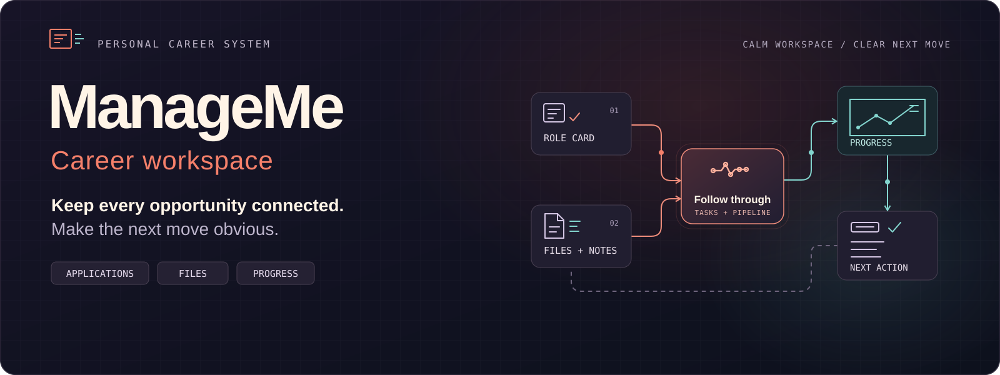

# ManageMe

**Run your career like a system, not a scatter of tabs.**

ManageMe is a private career workspace for keeping a job search and the work around it in one reliable place. Track each opportunity, retain the exact resume and supporting files that matter, turn follow-ups into work you can complete, and see what is actually moving through your pipeline.

[Installation & deployment](docs/installation/README.md) · [Product roadmap](docs/superpowers/roadmap.md) · [Implementation specs](docs/superpowers/specs/)

## What you can do

| Area | What it gives you |
| --- | --- |
| **Application pipeline** | Track companies and roles through Saved, Applied, Screening, Interview, Offer, Accepted, and Rejected. Use a drag-and-drop board or a sortable, filterable table. |
| **Career context** | Keep role details, source links, location, work mode, salary range, notes, company information, and the precise resume version sent for an application together. |
| **Resume library** | Create named resume tracks, upload append-only PDF versions, select the current version, and retain the version actually used for every application. Add skills and portfolio projects to each track. |
| **Document vault** | Store private career documents such as offer letters and certificates with tags, search, optional company links, and expiry-date visibility. |
| **Projects and tasks** | Manage standalone projects and tasks, or attach a task to an application so follow-ups stay in context. Track due dates and completion. |
| **QuickDrop and saved links** | Capture a thought or URL quickly, then triage it into a task, project, or saved reference. Keep a taggable library of useful links. |
| **Credential vault** | Keep third-party login details alongside your career work. Stored passwords are encrypted at rest with a dedicated AES-256-GCM key. |
| **Career analytics** | See your current pipeline, funnel and conversion history, stage timing, active-work velocity, company and resume outcomes, and recent activity based on recorded application changes. |

## How it fits together

1. **Capture the opportunity.** Add a company and application with the details you need to decide and act.
2. **Attach the evidence.** Link the resume version that was sent; file related documents; keep relevant links and notes close by.
3. **Make work visible.** Create application-linked follow-ups, standalone tasks, projects, or a quick inbox item to triage later.
4. **Move the pipeline deliberately.** Update status from a board or form. ManageMe records those changes so its history reflects the stages an opportunity has actually reached.
5. **Learn from the search.** Use the dashboard and analytics to inspect the live pipeline, conversion, stage duration, activity, and outcomes by company or resume.

## Privacy and data handling

ManageMe is designed around an account-scoped personal workspace:

- Every core record is owned by the signed-in user; file download routes check ownership before serving bytes.
- Resumes and documents are stored outside `public/` and are not exposed as guessable static URLs.
- Uploaded file content is validated by type, not only by the filename supplied by the browser.
- Credential passwords are encrypted with a dedicated application key. Labels, usernames, URLs, and notes are intentionally readable metadata so they can be listed without decrypting every record.
- Product-usage analytics are opt-in. Disabling them removes the recorded product events for the account.

These protections do not make the product a substitute for a dedicated password manager, a backup strategy, or legal/financial advice. In particular, a local upload directory must be backed up separately, and cloud storage credentials should be scoped to only the application bucket.

## Product boundaries

ManageMe is intentionally a focused, single-person workspace. It does not currently offer public sharing, team collaboration, global search across every module, resume parsing or AI rewriting, OCR, recurring tasks, manual card ordering, or custom pipeline stages. Document expiry is a visual signal today, not an automated reminder.

## Technology

| Layer | Stack |
| --- | --- |
| Application | Next.js 16, React 19, TypeScript |
| UI | Tailwind CSS v4, shadcn/ui, Lucide, dnd-kit |
| Identity and data | Auth.js v5, Prisma 7, PostgreSQL |
| File storage | Local durable volume, Cloudflare R2, or Backblaze B2 |
| Quality | Vitest and Playwright |
| Hosting | Node.js host or Vercel with object storage |

## Repository guide

```text
src/app/                 App Router pages, routes, and server actions
src/components/          Shared UI and application layout
src/server/              Services, repositories, file handling, storage, and validation
prisma/                  PostgreSQL schema and committed migrations
e2e/                     Browser workflows and fixtures
docs/                    Installation, product specifications, roadmap, and design notes
assets/                  README artwork and asset notes
```

Start with the [installation and deployment guide](docs/installation/README.md). The specifications in `docs/superpowers/specs/` document product decisions and acceptance criteria; they may describe historical phases or planned work, so the feature table above is the repository's concise guide to the current product.
